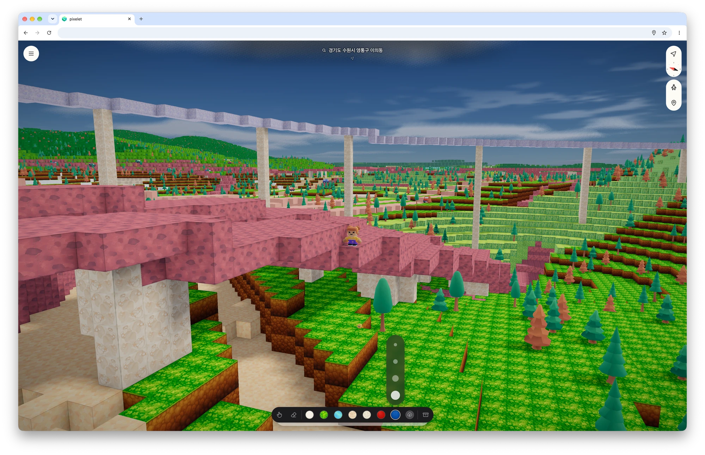

# pixelet

**[▶ Play](https://plei.me)**

> _A droplet fades. A pixelet remains._

_Started on December 15, 2025._

**pixelet puts the real Earth into blocks — your street, its buildings, the river beside it, the hills behind it — and lets you build on it.**



The planet is too large to load or draw at once, so how finely anything is drawn follows one rule: **the eye decides.** The view is a grid of cells of equal angle about the eye, so a cell grows with distance. Space is cut into cubes at every zoom; one cube of space at one zoom is a **node**, an address the world is asked about, never something stored. A block is drawn at the zoom whose block spans at least a cell where it stands (`pxl-spec-core grid.rs` `cell_at`). A city, a mountain range or a tower behind a ridge costs the cells it covers on the screen, not what it holds.

Every pixel's ray, every step a walker takes and every edit asks the world the same question: what fills this node? One function answers it (`pxl-spec-core world.rs` `node`), building the answer from the ground up: the ground's grid with its caves carved in it, then the ways off the ground over that, then what players placed over all. The function is compiled twice, for the CPU and through rust-gpu for the GPU (`pxl-spec-core cast.rs` `first`, `pxl-shader` `cast_cs`), so what is drawn is what is walked on and edited.

```text
 a pixel's ray        a walker's step       an edit
the GPU's cast            the CPU           the CPU
       └─────────────────────┼─────────────────┘
                             ▼
                   what fills this node?

              what players placed       ┐ each
              the ways off the ground   │ written
              the ground's grid,        │ over the
                its caves carved in it  ┘ one below
```

- **Real geography is baked ahead; what you build is live.** [Overture Maps](https://overturemaps.org/)' geometry, OpenStreetMap's coastline and [GEDTM30](https://doi.org/10.5281/zenodo.18887460)'s elevation are painted into tiles before anyone asks, and a tile is fetched only when the view lacks it; what players place is kept as they place it, and the trees and cars the ground grows are worked out where they stand, never stored.
- **The same world runs in a browser and on a device**, through one Rust kernel drawing with WebGPU.

---

## What runs where

The world lives in one Rust **kernel** (`pxl-kernel`, drawing through `pxl-render`). It runs as the guest of [xpute](./xpute/ARCHITECTURE.md), which runs one program inside another: the **host** owns the platform, grants the guest one memory once and a quota of time each turn, and does the outside work the guest asks for in that memory after each turn returns. xpute provides both ends and knows nothing of pixelet.

What the host is made of depends on where the kernel runs. The kernel's **bracket** plugs it into its place, calling the entry the kernel implements (`pxl-kernel door.rs` `intr`), and there are two, named for the guest's form. In a browser tab, `pxl-wasm` makes the kernel one WebAssembly module, and the page (`ts/app/web`) instantiates it and runs its GPU calls on the browser's WebGPU. On a device, `pxl-native` links the kernel into the app as a library that runs its own GPU calls on wgpu, and the app (`ts/app/native`) reaches it through one native module. Each app (`ts/app/web`, `ts/app/native`) bundles the client with that guest and hands the client its own bracket once, at its entry: the guest and the rest of what its place gives — storage, text, the network, the sensors, the surfaces drawn into (`ts/client/src/bracket.tsx` `Bracket`, made in each app's `src/bracket.ts`).

The **client** (`ts/client`) is the same TypeScript in both: the host (`src/host/`), with the kernel's vocabulary and boot in `src/abi/` and what answers its opens and writes in `src/io/`, which boots the kernel, submits each turn's frame and answers its reads, and the **shell** (`src/shell/`), the UI, which decides nothing about the world and changes it only by commands the kernel applies.

Almost nothing is computed at request time. Tiles and assets are baked ahead and served from the bucket under names that cannot come to mean something else — a tile under its bake's version, an asset under a hash of its own bytes; the one exception is forward search, which queries a database when asked. [ARCHITECTURE.md](./ARCHITECTURE.md) follows the kernel part by part.

| Layer     | Technology                                                                                                                     | Where                                                                                                                                         |
| --------- | ------------------------------------------------------------------------------------------------------------------------------ | --------------------------------------------------------------------------------------------------------------------------------------------- |
| Shell     | TypeScript, React 19 in React Native: react-native-web and Vite on a page, Expo on a device                                    | the browser, served by the Worker; the device app                                                                                             |
| Kernel    | Rust, no wasm-bindgen; `embassy-executor`: in one WebAssembly module on a page, in a static library linked into the device app | one memory reserved once: `PHONE_BYTES` in the device app and in a tab whose pointer is coarse, `DESKTOP_BYTES` in any other tab (`mem.json`) |
| Rendering | WebGPU (WGSL), driven from the kernel: the browser's, or wgpu over Metal on an iPhone and Vulkan on Android                    | the device's GPU                                                                                                                              |
| Edge      | Cloudflare Worker + R2                                                                                                         | the client, the baked tiles, the assets                                                                                                       |
| Servers   | Rust: axum, tokio-postgres — one per URL root, one database each                                                               | one VM behind Caddy                                                                                                                           |
| Databases | PostgreSQL: `db-main`, and `db-geo` with PostGIS                                                                               | the same VM                                                                                                                                   |
| Geodata   | Overture Maps + OSM land polygons + GEDTM30, ingested into db-geo, baked into tiles                                            | offline, into R2                                                                                                                              |
| Workspace | Make routes each task to its tree's own tool: Deno in `ts/`, Cargo in `rust/`, Make in `xpute/`; the scripts are Python and sh | —                                                                                                                                             |

```text
                every request
                      │
           one Worker, one origin
┌─────────────────────┴─────────────────┐
▼   answered here                       ▼   relayed to the VM
the client                              /geo/search ─▶ pxl-geo ─▶ db-geo
/tile        R2, by version                                     (PostGIS)
/asset       R2, by hashed path         /api        ─▶ pxl-api ─▶ db-main
filled by the bakes, offline
```

The four roots are written in one file, `spec/spec/route.json`, and every relay reads them from there. A push to the `deploy` branch, once the checks and tests pass here, takes a build number, rebuilds the servers and publishes the client from its one commit, and smoke-tests the result; [infra/README.md](./infra/README.md) has the procedures by hand.

One format was made here: **XTP**, xpute's relocatable binary tree, read without copying ([xpute/ARCHITECTURE.md](./xpute/ARCHITECTURE.md#the-message-and-the-packet-it-carries)).

---

## Getting Started

> Requires GNU Make, Python 3.11 or newer, [Deno](https://deno.land/) at the version `ts/.tool-versions` pins, Rust through [rustup](https://rustup.rs/), which takes the toolchain and its targets from `rust/rust-toolchain.toml`, Binaryen's `wasm-opt`, and Docker for the local databases. The dev and build tasks build the kernel module from `rust/` first. `make check` and `make test` take what [xpute/README.md](./xpute/README.md#running-it) lists besides; publishing the bucket takes the AWS CLI, and a deploy by hand and the usage report take wrangler.

```bash
git clone git@github.com:canplane/pixelet.git
cd pixelet

cp ts/app/web/.env.example ts/app/web/.env
# for the databases and the servers, below:
cp infra/local/.env.example infra/local/.env
cp rust/server/.env.example rust/server/.env

make dev
```

The agent instructions are [AGENTS.md](./AGENTS.md) and the procedures [.agents/skills/](./.agents/skills/), kept vendor-neutral. An assistant's own directory is gitignored; link it at them once per checkout:

```bash
mkdir -p .claude
ln -sfn ../AGENTS.md      .claude/CLAUDE.md
ln -sfn ../.agents/skills .claude/skills
```

A personal, uncommitted variant takes a `.local.` infix (`*.local.skill.md`, `.agents/skills/.local/`), which `.gitignore` keeps out.

The tiles come three ways, named as a bakery's bread is: delivered, from the oven, or off the shelf. `dev` has them delivered: every server route is proxied to the live deployment, so no Docker, database or server process is needed. That is the way in for most work, and the wrong way for bake work: a published tile prefix never changes, so the proxy would keep serving the tiles that are already live rather than the ones just baked. For that, start the databases and run the whole stack, which bakes each tile when it is first asked for:

```bash
docker compose -f infra/local/docker-compose.yml up -d
make dev-oven
```

`dev-shelf` is the same stack with the tiles taken from the last bakes under `./out` and nothing baked on demand: what a publish of them would show, before it is uploaded. `preview-oven` and `preview-shelf` are the two over the production bundle.

What runs across the trees is the Makefile's (`make -j8 check`, its trees in parallel); a script that runs alone is run by its path.

| Target                                | Description                                                                                                                                                                                                                                               |
| ------------------------------------- | --------------------------------------------------------------------------------------------------------------------------------------------------------------------------------------------------------------------------------------------------------- |
| `make dev`                            | The client alone, every route delivered by the live deployment                                                                                                                                                                                            |
| `make dev-oven`                       | The client and the three servers it talks to, each tile baked when first asked for                                                                                                                                                                        |
| `make dev-shelf`                      | `dev-oven`, with the tiles taken from the last bakes under `./out`                                                                                                                                                                                        |
| `make preview`                        | The production bundle, served locally, data from the live deployment                                                                                                                                                                                      |
| `make preview-oven` / `preview-shelf` | The production bundle over `dev-oven`'s or `dev-shelf`'s servers                                                                                                                                                                                          |
| `make dev-native`                     | Metro, for the device app                                                                                                                                                                                                                                 |
| `make spec`                           | Generate Rust and TypeScript from the JSON under `spec/`                                                                                                                                                                                                  |
| `make serve-<geo\|api\|tile>`         | One server: pxl-geo (`/geo`), pxl-api (`/api`), or the dev tile server, baking each tile out of the source when missed                                                                                                                                    |
| `make bake-<kind> [ARGS=…]`           | Make a kind's data: `terrain`, `place`, `division` from db-geo into `./out/<kind>/`; `earth` from `infra/earth/` into `./out/earth/`; `star` into the renderer's `bright-star.bin`; `geoid` with `ARGS=<egm2008-5.pgm>` into `spec/spec/space/geoid.json` |
| `make download-<what>`                | Fetch a source a tool reads: `pack`, the texture pack's; `moon`; `earth`; `star`                                                                                                                                                                          |
| `make ingest-asset`                   | Hash `asset/content/` into `./out/asset`, compose the texture pack, regenerate the asset tables                                                                                                                                                           |
| `make render-brand`                   | The symbol's outline both apps bundle, from `ts/client/brand/`; the page's icons and link preview are made by its build                                                                                                                                   |
| `make deploy`                         | Build the client and publish it with the Cloudflare Worker; CI runs it, after the checks and tests run here ([deploy skill](./.agents/skills/deploy/SKILL.md))                                                                                            |
| `make -j8 check`                      | Everything: format, rules, types, clippy, the device, the C++, the files made from `spec/`, the client's bundle as a deploy builds it                                                                                                                     |
| `make check-<tree>`                   | One tree's: `ts`, `rust`, `xpute`; or `rules`, `spec`, the files made from it, and `build`, the client's bundle                                                                                                                                           |
| `make -j8 test`                       | Every test: `test-ts`, `test-rust`, `test-xpute`                                                                                                                                                                                                          |
| `make lint` / `fmt`                   | Lint / format: `lint-ts`; `fmt-ts`, `fmt-rust`                                                                                                                                                                                                            |

| Script                    | Description                                                                                                              |
| ------------------------- | ------------------------------------------------------------------------------------------------------------------------ |
| `./script/publish.py`     | Declare in the bucket which baked version of each kind clients read; nothing in the tree changes and nothing is deployed |
| `./script/smoke.py <url>` | What a deployment must answer, against a running one                                                                     |
| `./script/check-diff.py`  | `check` and `test` over the working tree's changes                                                                       |

The oven's cache and the shelf's sets are files under `./out`, emptied by hand after a re-ingest or a bake change: `rm -rf out/oven`, or `rm -rf out/<kind> out/<kind>.stage out/<kind>.publish` to bake a kind from nothing.

db-geo is filled by each source's ingest, Overture's by `make ingest-overture` and the others' by their `ingest.sh` under `infra/geo/`, as [infra/geo/README.md](./infra/geo/README.md) says: they make a database's state rather than a file the tree keeps.

To measure the client, use `preview` (`localhost:4173`): the bundle as a deploy builds it, without the dev server's unbundled modules and hooks or the settings only a development build offers. The `profiler` setting opens the profiler's panel and records while it is open (`ts/client/src/shell/debug/profiler.tsx` `ProfilerPanel`), in either build.

A development page puts two things in the browser console once the kernel has booted (`ts/client/src/shell/debug/console.ts`, installed by `shell/boot.ts` under `__IS_DEV__`): `xpute`, the guest's doorbell, whose `cmd(command, ...args)` sends the kernel any command by its number with its arguments as the packet's fields, in order (`spec/client/kernel/domain/control/cmd.json` numbers them); and `pxl.profiler`, whose `report()` and `trace()` are the profiler panel's two exports.

### On a device

`ts/app/native` is the device's app: a React Native app, through Expo, that bundles the client, links the kernel in and takes every route from the live deployment. The bracket it hands the client is `src/bracket.ts`, over the native module under `modules/platform/`. Its native projects are generated by `expo prebuild` from `app.config.ts`, the config plugins and the module under `modules/platform/`, and are not kept. The kernel is built with the app, by a step of its native build (`ts/app/native/script/build-native.py`): a Debug build's with the kernel's dev settings, a Release build's without, as a deployed page's is. `make dev-native` runs Metro, which a Debug build loads its bundle from. Setting a machine up, building, installing and what has gone wrong are the [device-build skill](./.agents/skills/device-build/SKILL.md).

---

## Repository Structure

The tree is grouped by where a thing runs, and the kernel's modules by where they stand on the chain from the eye to the reads.

```
.
├── ts/                       # The TypeScript workspace (ts/deno.jsonc)
│   ├── client/               #   the client, which both apps bundle
│   │   ├── brand/            #     the icons and symbol both apps and the shell draw
│   │   └── src/
│   │       ├── bracket.tsx   #     what the client asks of the place it runs in
│   │       ├── host/         #     the host: xpute's host mounted with the one spec it is handed (mem)
│   │       ├── abi/          #     the kernel's commands, snapshot, text calls, the GPU's state and boot, its specs generated
│   │       ├── io/           #     what answers the kernel's opens and writes: tiles, assets, storage, the source, online
│   │       ├── config/       #     deployment config and routes
│   │       └── shell/        #     the UI: frame, world, settings, search, debug, ui kit (pill.ios.tsx beside pill.tsx), locale
│   │           └── catalog/  #       the data screens show (cells, assets)
│   ├── app/                  #   each app, which bundles the client with the guest and hands it its bracket
│   │   ├── web/              #     the page's: its entry, the client's bracket (src/bracket.ts), the guest module's build (script/)
│   │   └── native/           #     the device's, through Expo and Metro
│   │       ├── src/          #       its entry and the client's bracket (bracket.ts): what the app gives it, through its native module
│   │       └── modules/      #       platform/, its native half: one module, the views, the linked kernel
│   ├── server/edge/          #   the Cloudflare Worker that serves it all
│   └── build/                #   what the bundlers and build scripts read the workspace through
├── rust/                     # The Rust workspace, grouped by where a crate runs
│   ├── spec/                 #   pxl-spec: the model every crate shares
│   │   └── core/             #     pxl-spec-core: what the CPU and the GPU compute alike
│   ├── client/               #   what the client runs
│   │   ├── render/           #     pxl-render: the view
│   │   ├── kernel/           #     pxl-kernel: the kernel
│   │   └── shader/           #     pxl-shader: pxl-spec-core's compute entries, built to WGSL apart
│   ├── client-bracket/       #   where the client is plugged in to run, no domain
│   │   ├── wasm/             #     pxl-wasm: the guest as one WebAssembly module
│   │   └── native/           #     pxl-native: the guest as a device app's library
│   ├── server/               #   pxl-server: what geo and api both need to start
│   │   ├── geo-spec/         #     pxl-geo-spec: geographic provider values (Overture today)
│   │   ├── geo/              #     pxl-geo: the world's data server (/geo)
│   │   ├── api/              #     pxl-api: the application server (/api)
│   │   └── geo-bake/         #     pxl-geo-bake: the tile bakes and the dev tile server
│   └── tool/                 #   pxl-tool: the binaries that write files the tree keeps
├── spec/                     # JSON every language is generated from (pxl-tool),
│                             #   grouped as rust/ is: spec/, client/
├── xpute/                    # The system under it, its own repository's root and workspaces:
│                             #   rust/, ts/ and cpp/ by language: kit, guest, host; spec/ the contract
├── asset/                    # Shipped models, texture pack and sky, imported by nothing
├── script/                   # The repository's own scripts, in Python and sh, reading none of its code: the deploy, its build number, log and smoke, the bucket's publish, the narrowed check, the local environment
├── infra/                    # Local and production compose files, and what fills db-geo
└── doc/                      # The record: backlog.md what is queued, minutes/ each meeting's
                              #   record (archive/ those retired), experiment/ measurements
```

**What shares `pxl-spec` is Rust, and what does not is free.** The kernel, the servers, the bakes and the asset ingest compile the model, so they are crates; the Overture ingest reads the coverage's shards too, so it is a pxl-geo-bake binary (`make ingest-overture`), while the elevation and coast ingests drive GDAL and Postgres over a provider's data and are scripts under `infra/geo/`. The client is TypeScript because it decides nothing about the world; what it needs of the model — catalogs, ABI enums, routes — is generated into `ts/client/src/**/*.spec.ts` from the same JSON the Rust is generated from.

| Crate / package  | What it is                                                                                                                                                                      |
| ---------------- | ------------------------------------------------------------------------------------------------------------------------------------------------------------------------------- |
| `pxl-spec`       | The model: the position, the zooms and lattices, the asset catalog, the command numbers, the tile formats, the asset tables. One implementation.                                |
| `pxl-spec-core`  | The part of the model the GPU computes too, one source for both: the zooms' cells, the caves, the ground, the decor it grows, the world's one query and a ray's descent.        |
| `pxl-render`     | The view: glTF, the marker sheet, the draw list, the shaders, the renderer. It knows no kernel.                                                                                 |
| `pxl-kernel`     | The kernel: the chain from the scene down to the reads, the turn, the memory's tenants, the profiler.                                                                           |
| `pxl-shader`     | `pxl-spec-core` as the GPU's compute entries, built to WGSL through rust-gpu by `cargo shader-wgsl` (pxl-tool) and checked in beside the renderer's shaders.                    |
| `pxl-wasm`       | The guest in a tab: one module that fixes the memory's front with linker flags, imports the clock and exports xpute's entry, `intr`.                                            |
| `pxl-native`     | The guest on a device: a static library behind one C header (`include/pxl_native.h`), over xpute's native host, which runs every call on a thread of its own.                   |
| `ts/client`      | The client, the same in both apps: the host, the kernel's vocabulary and boot, the roots' backends and the shell, handed what its place gives (`src/bracket.tsx`).              |
| `ts/app/web`     | The page's app: its entry, and the client's bracket (`src/bracket.ts`), what a browser tab gives the client, the guest it instantiates included.                                |
| `ts/app/native`  | The device's app: its entry, and the client's bracket (`src/bracket.ts`), what it gives the client through its native module, which links the kernel.                           |
| `ts/server/edge` | The Cloudflare Worker in front of it all: the page's bundle, the bucket's objects, and `/geo` and `/api` relayed to the servers; a deploy stages the page's bundle beside it.   |
| `pxl-server`     | What both servers need before answering: the environment, the database pool, the gate over internal routes.                                                                     |
| `pxl-geo-spec`   | What the geo server and the bakes agree on about db-geo: table names, and what Overture's categories and divisions mean.                                                        |
| `pxl-geo`        | The world's server: forward search, the one route that queries a database at request time.                                                                                      |
| `pxl-api`        | The application's server.                                                                                                                                                       |
| `pxl-geo-bake`   | The bakes — terrain, place, division, earth, the stars — and, behind a feature each, the dev tile server and the Overture ingest.                                               |
| `pxl-tool`       | Hashes `asset/` into the bucket's shape and writes the asset tables; generates code from `spec/` and the WGSL; checks the rules; fetches sources; bakes the geoid, the brand.   |

A crate's root holds its modules, the directories sorted by kind and the one-file modules after them; `pxl-geo`, `pxl-api` and `pxl-geo-spec` are flat. The kernel's are named as the chain is:

| Where                   | `pxl-kernel` modules                      |
| ----------------------- | ----------------------------------------- |
| the top                 | `turn` `door` `shell`                     |
| `domain`, the two heads | `scene` `control`                         |
| `domain`, the trunk     | `view` `query` `layer`                    |
| `domain`, at its root   | `approach` `param`, which both heads read |
| `sys`, under everyone   | `io` `sched` `mem` `load`                 |
| beside                  | `profiler`                                |

A leaf sits under its lowest reader: the settings under `view`, the models and decor under `query`, the markers under `scene`, and each tuned number in a `param` beside the lowest part that reads it.

One gitignored tree holds what the tree makes: `out/` is what the bakes and the asset ingest write, in the shape the bucket holds, and under it `out/oven/` is what `dev-oven` bakes on demand, deleted at no cost. Scratch — logs, probes, diffs — goes in `tmp/`, which `.gitignore` keeps out, and is deleted when done. What an ingest makes on its way into db-geo, the warped elevation, stays beside its script (`infra/geo/elevation/warped/`).

The casing in the tree is not mixed by accident, and React is the line. Below the shell — Rust, the xpute packages, the client's host, abi, io and config (`ts/client/src/{host,abi,io,config}/`), the brackets and the boot — the code shares one `snake_case` vocabulary across the boundary, a word under its namespace where it can be one: `len`, `new_len`, `bracket.gpu.boot`. What is below hands the shell a value and a way to watch it (`watch_snapshot`, `watch_gpu`), never a hook. The shell, the catalog it shows and the scripts are `camelCase`, as TypeScript is, and React's hooks and components keep React's names wherever they sit (`shell/store/system.ts` wraps what is below). A name that crosses — a snapshot field, a packet's field, a catalog entry — keeps the kernel's.

---

## Learn More

[AGENTS.md](./AGENTS.md) is how to work in the tree, [doc/backlog.md](./doc/backlog.md) what is queued next, and [doc/minutes/](./doc/minutes/) why things went the way they did.

`xpute/` is xpute's repository root, developed here and copied out byte for byte by `xpute/script/export.py`: [xpute/README.md](./xpute/README.md) and [xpute/ARCHITECTURE.md](./xpute/ARCHITECTURE.md) are the system under the application — its memory, rings, turn, handles, contract and wire formats — with `xpute/LICENSE` and `xpute/THIRD_PARTY_NOTICES.md` beside them. Nothing under it names pixelet.

---

[github.com/canplane/pixelet](https://github.com/canplane/pixelet)
