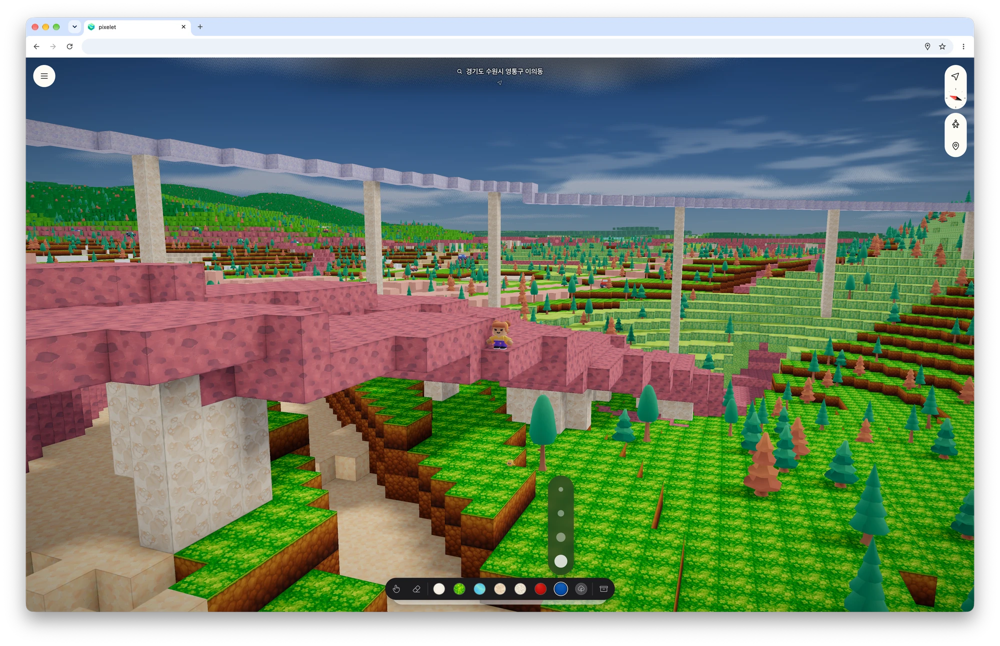

# pixelet

**[▶ Play](https://plei.me)**

> _A droplet fades. A pixelet remains._

_Started on December 15, 2025._

**pixelet puts the real Earth into cubes — your street, its buildings, the river
beside it, the hills behind it — and lets you build on it.**



The planet is too large to load or draw at once, so how finely anything is drawn
follows one rule: **the eye decides.** The view is a grid of cells of equal
angle about the eye, so a cell grows with distance. Space is cut into cubes at
every zoom; one cube of space at one zoom is a **node**, an address the world is
asked about, never something stored. Wherever it stands, the world is drawn at
the zoom whose nodes span a cell there (`pxl-engine grid.rs` `cell_zoom_at`).
A city, a mountain range or a tower behind a ridge costs the cells it covers on
the screen, not what it holds.

Every pixel's ray, every step a walker takes, the pointer and every edit ask the
world the same question: what fills this node? One function answers it, each
layer written over the one below (`pxl-engine world.rs` `node`). The CPU runs
it as written; the GPU runs it written again by hand in WGSL (pxl-render
`world.wgsl`), held word for word to the Rust by a test
(`rust/client/render/tests/world.rs`), so what is drawn is what is walked on
and edited.

```text
  a pixel's ray      a walker's step      the pointer      an edit
   (the GPU)           (the CPU)          (the CPU)       (the CPU)
       └──────────────────┴──────────┬──────┴───────────────┘
                                     ▼
                         what fills this node?
                                     │
                  what players placed              ┐ each written
                  the ways off the ground          │ over the one
                  the ground's grid and its caves  ┘ below it
```

Real geography is baked ahead: [Overture Maps](https://overturemaps.org/)'
geometry, OpenStreetMap's coastline and
[GEDTM30](https://doi.org/10.5281/zenodo.18887460)'s elevation are painted into
tiles, fetched only when the view lacks one. What players build is kept as they
place it, and the trees and cars the ground generates are worked out where they
stand, never stored. The same world runs in a browser and on a device, through
one Rust core drawing with WebGPU.

---

## What runs where

The world lives in one Rust **core** (`pxl-core`, drawing through
`pxl-render`), on [xpute](./xpute/README.md): `pxl-core` and `xpute-core`, its
library OS, are linked into one image, a unikernel on a virtual machine. The
**runtime** is its VMM: it implements the devices the core's machine asks for,
the GPU and the files, grants the core one memory and a deadline on each call
into it, a **turn**, and does the outside work the core asked for once the turn
returns.

The core's crate is its artifact, in the form xpute gives its target. One
Expo app (`ts/client`) is built for iOS, Android and the page. In a browser tab
the core is one WebAssembly module, which the page runs on the browser's
WebGPU; on a device it is the library linked into the app, whose GPU calls
xpute's runtime runs on wgpu. The app bundles the **client** (`ts/client`): the
runtime (`src/runtime/`); the services, what each platform gives, the core,
storage, text, the network, the sensors and the surfaces (`src/service/`, a
page's `x.ts` beside a device's `x.native.ts`), what answers the core's
imports, its files among them (`src/sys/`), what the app's ABI carries
(`src/port/`) and the server it reads from (`src/origin/`); the numbers both
read and the boot (`src/abi/`); and the **UI** (`src/ui/`), the client outside
the VM, which changes the world only by commands the core applies.

Almost nothing is computed at request time. Tiles and assets are served from a
bucket under names that never come to mean something else, a tile under its
bake's version and an asset under a hash of its bytes; forward search alone
queries a database when asked.

| Layer     | Technology                                                                     |
| --------- | ------------------------------------------------------------------------------ |
| UI        | TypeScript, React 19 in React Native through Expo: react-native-web on a page   |
| Core      | Rust, one WebAssembly module on a page, a static library in the device app     |
| Rendering | WebGPU (WGSL): the browser's, or wgpu over Metal or Vulkan on a device          |
| Edge      | Cloudflare Worker + R2                                                         |
| Servers   | Rust: axum, tokio-postgres, one per URL root, one database each, on one VM     |
| Databases | PostgreSQL: `db-main`, and `db-geo` with PostGIS                               |
| Geodata   | Overture Maps, OSM land polygons and GEDTM30, ingested into db-geo and baked   |

```text
                every request
                      │
           one Worker, one origin
┌─────────────────────┴─────────────────┐
▼   answered here                       ▼   relayed to the VM
the client                              /geo/search ─▶ pxl-geo ─▶ db-geo
/tile        R2, by version                                     (PostGIS)
/asset       R2, by hashed path         /api        ─▶ pxl-api ─▶ db-main
filled by the bakes, offline
```

The four roots are written once, in `spec/spec/route.json`, and every relay
reads them there. A push to the `deploy` branch, once the checks and tests pass
here, rebuilds the servers, publishes the client and smoke-tests the result
([infra/README.md](./infra/README.md) has the procedures by hand).

---

## Getting Started

> Requires GNU Make, Python 3.11 or newer, [Node](https://nodejs.org/) at the
> version `ts/.tool-versions` pins with pnpm (`corepack enable`, or
> `npm i -g pnpm@10`), Rust through [rustup](https://rustup.rs/)
> (the toolchain is `rust/rust-toolchain.toml`'s), Binaryen's `wasm-opt`, and
> Docker for the local databases and the shaders' build. `make check` and
> `make test` take what [xpute/README.md](./xpute/README.md#running-it) lists
> besides; publishing the bucket takes the AWS CLI, and a deploy by hand
> wrangler.

```bash
git clone git@github.com:canplane/pixelet.git
cd pixelet

# for the databases and the servers, below:
cp infra/local/.env.example infra/local/.env
cp rust/server/.env.example rust/server/.env

make install
make dev
```

The tiles come three ways, named as a bakery's bread is. `dev` has them
delivered: every server route is proxied to the live deployment, so no database
or server runs here. Bake work needs the oven, the whole stack baking each tile
when it is first asked for:

```bash
docker compose -f infra/local/docker-compose.yml up -d
make dev-oven
```

`dev-shelf` is that stack with the tiles taken from the last bakes under
`./out`, what a publish of them would show. `preview`, `preview-oven` and
`preview-shelf` are the same three over the production bundle, which is the one
to measure speed in.

The page is Expo's web build, bundled by Metro into one HTML file over one
bundle. `dev` runs `expo start --web` beside a Rust watcher that rebuilds the
core's module, `ts/client/public/core.wasm` (`ts/client/script/build-wasm.py`),
which the page fetches as `/core.wasm?v=<build id>`. `ts/client/index.html` is
the page's template, which `ts/client/script/web.ts html` writes into `public/`;
`web.ts stamp` writes `dist/build.json` after an export, and `web.ts serve`
serves `dist/` for a preview. The dev server and the preview forward the
server routes as the Worker does (`ts/client/script/proxy.ts`), by what the
environment says:

| Variable                                                    | What it sets                                                       |
| ----------------------------------------------------------- | ------------------------------------------------------------------ |
| `PXL_DEV_SOURCE`                                            | `delivery` (the default), `oven` or `shelf`, as the targets set it |
| `PXL_REMOTE_ORIGIN`                                         | The deployment `delivery` reads from, else the site                |
| `PXL_GEO_BASE_URL`, `PXL_TILE_BASE_URL`, `PXL_API_BASE_URL` | The local servers, `127.0.0.1` on 3000, 3001 and 3002 by default   |
| `PXL_PREVIEW_PORT`                                          | The preview's port, 4173 by default                                |

In `ts/client`, `pnpm web`, `web:oven` and `web:shelf` are the dev server,
`build:web` the export a deploy publishes, `preview[:oven|:shelf]` the export
served, `build:wasm[:published]` the core's module and `build:brand` the
symbol's outline.

| Target                          | Description                                                          |
| ------------------------------- | -------------------------------------------------------------------- |
| `make dev`                      | The client alone, every route from the live deployment               |
| `make dev-oven` / `dev-shelf`   | The client and its servers, tiles baked on demand / off the last bakes |
| `make preview[-oven\|-shelf]`   | The same over the production bundle                                  |
| `make dev-native`               | Metro, for a device's Debug build                                    |
| `make spec`                     | Generate Rust and TypeScript from the JSON under `spec/`             |
| `make serve-<geo\|api\|tile>`   | One server, or the dev tile server                                   |
| `make bake-<kind> [ARGS=…]`     | Make a kind's data: `terrain`, `place`, `division`, `earth`, `star`, `geoid` |
| `make ingest-<overture\|asset>` | Fill db-geo from Overture; hash `asset/content/` into `./out/asset`  |
| `make download-<what>`          | Fetch a source a tool reads: `pack`, `moon`, `earth`, `star`         |
| `make render-brand`             | The symbol's outline the app bundles                                 |
| `make deploy`                   | Build and publish the client with the Worker; CI runs it             |
| `make install`                  | Every tree's packages: `ts/`'s and xpute's                           |
| `make -j8 check` / `test`       | Every check / every test, or one tree's: `check-ts`, `test-rust`, …  |
| `make lint` / `fmt`             | Lint / format                                                        |

The repository's own scripts are run by their path: `script/publish.py` declares
which baked version of each kind clients read, `script/smoke.py` checks a
running deployment, `script/check-diff.py` checks the working tree's changes,
and `script/build-log.py` lists the published builds. What the bakes make is
under `./out`, emptied by hand after a re-ingest or a bake change (`rm -rf
out/oven`, or `out/<kind>*` to bake a kind from nothing); db-geo is filled by
each source's ingest ([infra/geo/README.md](./infra/geo/README.md)).

A development page puts two things in the browser console
(`ts/client/src/ui/debug/console.ts`): `xpute.cmd(command, ...args)`, which
sends the core any command by its number
(`rust/client/core/ui.json`), and `pxl.perf`, the profiler
panel's `report()` and `trace()`.

The agent instructions are [AGENTS.md](./AGENTS.md) and the procedures
[.agents/skills/](./.agents/skills/), kept vendor-neutral; an assistant's own
directory links to them once per checkout:

```bash
mkdir -p .claude
ln -sfn ../AGENTS.md      .claude/CLAUDE.md
ln -sfn ../.agents/skills .claude/skills
```

### On a device

On a device `ts/client` bundles the client, links the core in and takes every
route from the live deployment. Its native projects (`ts/client/ios/`,
`ts/client/android/`) are generated by `expo prebuild` and not kept. The core,
`pxl-core`, is built with the app by a step of its native build, through
xpute's React Native module, `@xpute/native`
(`xpute/ts/native/script/build-core.py`); the app's own native module is
`ts/client/modules/platform/`. Setting a machine up, building and installing are
the [device-build skill](./.agents/skills/device-build/SKILL.md).

---

## Repository Structure

The tree is grouped by language, each a root of its own tool, and within a
language by where a thing runs.

```
.
├── ts/                  # The TypeScript workspace (pnpm)
│   ├── client/          #   the client the app bundles
│   │   └── src/
│   │       ├── runtime/  #     xpute's runtime, mounted
│   │       ├── service/ #     what each platform gives
│   │       ├── sys/      #     what answers the core's imports
│   │       ├── port/     #     what the app's ABI carries
│   │       ├── origin/   #     the server the client reads from
│   │       ├── abi/      #     the numbers both read, and the boot
│   │       └── ui/       #     the UI
│   ├── app/             #   the Expo app: iOS, Android and the page
│   ├── server/edge/     #   the Cloudflare Worker that serves it all
│   └── build/           #   what the bundlers read the workspace through
├── rust/                # The Rust workspace (Cargo)
│   ├── spec/            #   pxl-spec: the model every crate shares
│   │   ├── engine/      #     pxl-engine: what CPU and GPU both compute
│   │   └── content/     #     pxl-content: pixelet's content over it
│   ├── client/          #   pxl-core and pxl-render, its shaders WGSL by
│   │                    #     hand
│   ├── server/          #   pxl-geo (/geo), pxl-api (/api), pxl-server,
│   │                    #     pxl-geo-spec; pxl-geo-bake, the bakes
│   └── tool/            #   pxl-tool: the repository's own Rust programs, run by cargo
├── spec/                # JSON every language's code is generated from
├── xpute/               # The system under it, its own repository's root
├── asset/               # The shipped models, texture pack and sky
├── script/              # The repository's own scripts (Python, sh)
├── infra/               # Compose files; db-geo's ingests
└── doc/                 # The record: backlog, minutes, experiments
```

What shares the model is Rust: the core, the servers and the bakes compile
`pxl-spec`. The client is TypeScript, and what it needs of the model, catalogs,
command numbers and routes, is generated into `ts/client/src/**/*.spec.ts` from
the same JSON.

Below the UI, Rust, xpute and the client's runtime, abi and namespace share one
`snake_case` vocabulary across the boundary; the UI and the scripts are
`camelCase`, as TypeScript is. A name that crosses, a snapshot field, a packet's
field or a catalog entry, keeps the core's.

---

## Learn More

[ARCHITECTURE.md](./ARCHITECTURE.md) follows the core part by part,
[AGENTS.md](./AGENTS.md) is how to work in the tree, and
[doc/backlog.md](./doc/backlog.md) what is queued next.

`xpute/` is xpute's repository root, developed here and copied out byte for
byte by `xpute/script/export.py`; [xpute/README.md](./xpute/README.md) and
[xpute/ARCHITECTURE.md](./xpute/ARCHITECTURE.md) describe the system under the
application. Nothing under it names pixelet. pixelet takes it through its
packages, as any program would: `ts/pnpm-workspace.yaml` lists xpute's, which
the client and the app depend on as `workspace:*`, and `rust/Cargo.toml` names
the crates by path.

---

[github.com/canplane/pixelet](https://github.com/canplane/pixelet)
