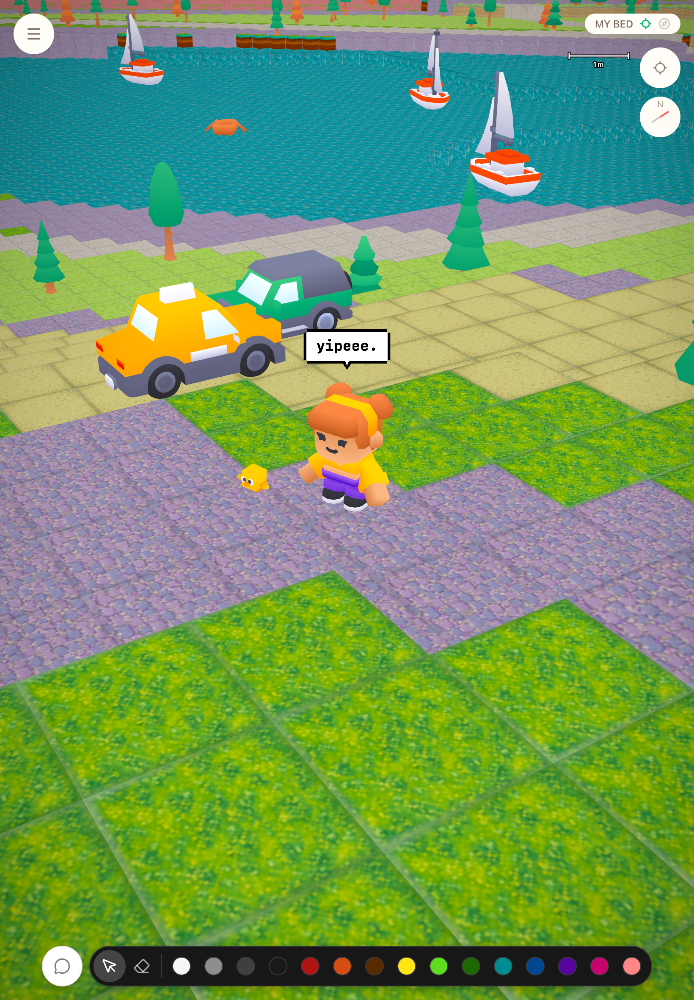

# pixelet

**[▶ Play](https://plei.me)**

> _A droplet fades. A pixelet remains._

_Started on December 15, 2025._

**pixelet** is a location-based spatial world built over real-world geodata ([OpenStreetMap](https://www.openstreetmap.org/) + [GEDTM30](https://doi.org/10.5281/zenodo.15689805) elevation) — terrain rendered as voxels, with a separate voxel-object layer for building on top of it.



---

## Getting Started

> Requires [Deno](https://deno.land/) 2.x and Docker (for the local Postgres databases).

```bash
git clone git@github.com:canplane/pixelet.git
cd pixelet

cp .env.example .env
cp apps/web/.env.example apps/web/.env

docker compose --env-file .env -f infra/docker-compose.yml up -d

deno task dev
```

| Task                  | Description                  |
| --------------------- | ---------------------------- |
| `deno task dev`       | Start web + api concurrently |
| `deno task dev:web`   | Frontend only                |
| `deno task dev:api`   | Backend only                 |
| `deno task build:web` | Build frontend               |
| `deno task build:api` | Build backend                |
| `deno task check`     | Type-check all packages      |
| `deno task test`      | Run all tests                |
| `deno task lint`      | Lint                         |
| `deno task fmt`       | Format                       |

---

## Tech Stack

The monorepo, package management, and task execution are unified under Deno.
The web app uses Vite as its bundling/build entry; the api runs directly under Deno.

| Layer               | Technology                                          |
| ------------------- | --------------------------------------------------- |
| Runtime / Workspace | Deno + TypeScript                                   |
| Bundler (web)       | Vite                                                |
| Web UI              | React 19                                            |
| API                 | Hono                                                |
| 3D Rendering        | Three.js + React Three Fiber                        |
| Database            | PostgreSQL (main + geographic/PostGIS)              |
| Geodata             | OpenStreetMap (OSM) + GEDTM30 (elevation)           |

Two more pieces of the stack are built for this project rather than adopted: a packed fixed-point coordinate format (PVF3) and a typed-array wire protocol (XTP) for terrain transport. See [Repository Structure](#repository-structure) and [World and Rendering Model](#world-and-rendering-model) below, or [ARCHITECTURE.md](./ARCHITECTURE.md) for the full design.

**Naming:** Most identifiers here — files, functions, locals — use `snake_case` rather than TypeScript's usual `camelCase` (React hooks, stores, and components keep the ecosystem's own convention, since fighting that adds no value). The engine side of pixelet leans toward data-oriented design, closer to systems programming than typical frontend code, and a WebGPU/WASM path — including a partial Rust port — has been on the table from early on. C/C++/Rust-style abbreviations show up throughout (`len`, `u32`, `new_len` in `@xpute/core/ds`, for instance), and those read oddly bolted onto camelCase (`newLen` next to `len`); `snake_case` sits naturally with them instead. Unifying most of the TypeScript around it also keeps the two languages visually consistent at the boundary.

---

## Repository Structure

```
.
├── apps/
│   ├── web/                        # Web client (Deno + Vite + React 19 + R3F)
│   └── api/                        # API server (Deno + Hono), OSM bake pipeline
│
└── packages/
    ├── xpute/
    │   └── core/                   # Generic kit/collections/io/errors + XTP binary protocol
    │                                # (no pixelet domain knowledge — portable to other projects)
    │
    └── pxl/
        └── shared/                 # PVF3 coordinate system, cell/terrain model, bake wire format
                                     # (pixelet-specific — must stay identical between web and api)
```

The engine is split into a pixelet-specific domain layer (`@pxl/shared`) and a project-agnostic utility layer (`@xpute/core`) that `@pxl/shared`'s binary formats are built on.

---

## World and Rendering Model

Storage, network transfer, and rendering deliberately use different scales. See [ARCHITECTURE.md](./ARCHITECTURE.md#spatial-hierarchy) for the full L0–L5 hierarchy and the layer/space/shape terminology it's built from — in short:

- **L1 Block** (`1u` per axis): the canonical cell — a **Voxel** once it carries a material payload.
- **L2 Chunk** (`64` blocks per axis): the renderer's render/LOD/raycasting unit. The renderer composes it into a `64³` **Volume** per occupied **Band** (one signed-Z slice), grouping all occupied L2 bands at one XY address into one column component.
- **L3 Page** (`1024` blocks per axis): terrain's streaming/storage unit — terrain stores a `1024²` **Tile** there, X/Y only.
- **L4 Anchor** (`4096` blocks per axis): the floating-origin frame. `get_local_world_origin` snaps the camera's map center down to its L4 base; `AnchorRegistry` keeps one ref-counted `THREE.Group` per live L4 index and re-bases every group's local position when that snapped origin shifts. Carries no Tile/Volume payload of its own — a pure addressing/reparenting mechanism.
- **L5 Shard** (`65536` blocks per axis): reserved for a future global sharding domain — not implemented (`L5_SHAMT` stays commented out in `indexer.ts`). Once active, its Z lane collapses (Z is only 16 bits, narrower than `L5_SHAMT`), so L5 can only ever address X/Y.

Terrain (a Tile-shaped layer) stays dense 2.5D page data; placed objects (a Volume-shaped layer) stay sparse octrees in source storage. Object leaf byte `0` is `OBJECT_UNDEF` (sparse absence/fallback); `0x80` is explicit AIR (retains the leaf, erasing whatever a lower layer would otherwise show), `0xff` is UNKNOWN, and every other real value is a placed cube color, terrain-styled pick, or decor kind (`cell/cube.ts`, `cell/decor.ts`, `cell/mod.ts`). At render time, both implement the same `WorldLayer` contract and paint into one temporary signed-Z Volume of Voxels. The same composed boxes drive meshing and raycasting, so rendered and clickable geometry cannot diverge by using separate approximations.

Dense `64³` Volumes exist only while composing and meshing. Long-lived state keeps compact surface data and GPU-ready instance buffers instead, avoiding the mobile memory cost of retaining a dense Volume for every visible chunk. Most of this pipeline is renderer-independent typed-array math; Three.js / React Three Fiber owns the final scene, material, texture, frustum, and GPU submission boundary.

---

## Learn More

See [ARCHITECTURE.md](./ARCHITECTURE.md) for how the coordinate system, spatial hierarchy, unified world-layer pipeline, and wire format work under the hood. See [discussions/](./discussions/) for the reasoning behind those design decisions.

---

[github.com/canplane/pixelet](https://github.com/canplane/pixelet)
